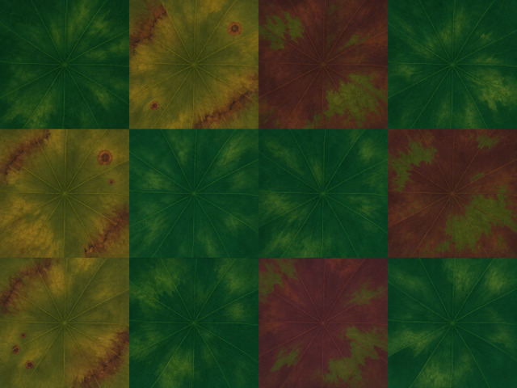

# Calm Reflective Water for Morrowind

A water shader modification for OpenMW RTX and an optional water-lily plugin for Tamriel Rebuilt. Calmer ripples carry reflections across the surface. In the shallows, daylight draws caustic lines across the bed, with bright glints where the lines meet. Overcast weather softens the pattern away. A dark mustard tannin tint fades gradually into deeper water.

## Lily beds and koi

Animated lilies have clearance throughout their sway cycle. Koi swim just below the surface in the gaps beside the pads. Their hinged tails beat in short bursts and straighten as the fish glide. Four skin patterns use base color, scale normals, and dielectric roughness maps. The markings follow Kohaku, Sanke, Showa, and Tancho varieties. [Kodama Koi Farm](https://www.kodamakoifarm.com/koi-patterns-and-markings/) · [Koi swimming kinematics](https://pubmed.ncbi.nlm.nih.gov/17562892/)

Sunny weather gives the undersides of the pads a slight glow that peaks at noon. The lily beds mix green, bronze and aging yellow pads. Branching veins, mottled interiors and rust-colored margins are painted into twelve diffuse textures and embedded in the animated meshes.

The shoreline depth check skips koi and lily pads, so either one near the surface does not make the water around it appear shallow.

## Caustics and rain sediment

The original 0.4.5 build uses custom caustics. Sunlight reflected off the water casts moving caustics onto nearby rocks and overhangs. Below the surface, refracted sunlight lights the bed and submerged objects. Segments of the fine Voronoi ridges fade in and out as the water moves. A feathered saturation boost peaks at 94% above the original saturation and spans 4.5 world units at the middle of the shoreline reflection transition. Under **Options → Scripts → Tamriel Water**, **Disturbed sediment** controls the maximum strength of the brown silt lifted by rain. At full strength the silt covers the entire view beneath the reflections, including deep water. After rain it settles over three minutes of simulation time.



## Performance on OpenMW RTX 0.4.5

The renderer caches the sediment level and underside lighting for lily pads each frame. Water and surface shaders read those values from an existing GPU texture, saving repeated ray queries. The animated caustic pattern is the same as in the previous version.

Measured in a fixed view over a Narsis lily bed with koi, using a Radeon RX 9070 XT at 2560 × 1440, FSR Quality and two bounce rays. The baseline is the previous Tamriel Water shader. Uncapped FPS and clear-water power are averages of two runs per version, with run order reversed. Maximum sediment was forced for one comparison.

| Measurement | Previous shader | Updated shader |
|---|---:|---:|
| Uncapped FPS | 68.4 | 72.8 |
| GPU power with a 60 FPS cap, clear water | 303 W | 298 W |
| GPU power with a 60 FPS cap, maximum sediment | 305 W | 298 W |

## Water installation

### OpenMW RTX 26.11.7

The 26.11.7 port projects a local triangular mesh of animated wave normals onto the horizontal plane at each shading point. Each triangle contributes more light as its projected area shrinks, and overlapping triangles add their light. The light source’s angular size and pixel footprint soften the edges. Neighboring cells alternate their triangle diagonals. A broad feather surrounds a narrower, softened highlight where light paths cross. Below the surface, neutral light is scaled to about 30% luminance with a warm tint. The local calculation bounds displacement at grazing angles. Sunlit caustics also add light on the bed and on nearby surfaces facing the water. The amber tannin becomes visible in shallow water and fades out by a depth of 5,760 world units.

This release embeds its Vulkan shaders in the game executable. Apply the port to a checkout of the release and build the game with the upstream build driver:

```sh
git checkout rtx-v26.11.7
git apply /path/to/source/water-26.11.7.patch
./omw release build openmw
```

Run the resulting executable with the 26.11.7 resources and your usual game profile. The lily beds, koi and sediment control use the plugin below.

### OpenMW RTX 0.4.5

Use [OpenMW RTX rtx-v0.4.5](https://github.com/xorza/openmw-rtx/releases/tag/rtx-v0.4.5). Make a full copy of that installation’s resources directory. Overlay this project's resources directory onto the copy, merging the rtx/shaders directories. Launch OpenMW RTX with the absolute path of the completed copy:

```sh
openmw --resources "/path/to/copied/resources"
```

To revert the water, launch with your original resources directory.

## Installing the optional lily beds and koi

The same plugin supplies the lily beds, all four koi varieties and the disturbed-sediment control. The supplied ESP declares Morrowind.esm, Bloodmoon.esm, Tamriel_Data.esm, TR_Mainland.esm and Anthology Solstheim.esm as masters. With those installed and enabled, add the following to the active openmw.cfg, substituting the absolute path where you installed this project. Load the lily plugin after its masters.

```ini
data="/path/to/Monet Water Lilies"
content=Monet Water Lilies.esp
```

## Source and credits

The 0.4.5 water shaders build on [xorza/openmw-rtx](https://github.com/xorza/openmw-rtx/tree/69ca79e6ab710a04052836c981fcc544f53da9c0). The source patch is relative to that exact revision. From a checkout of that revision, run `git apply /path/to/source/water.patch` and follow the upstream RTX shader build. The upstream license is included in [source/LICENSE](source/LICENSE).

Developed by Francisco in collaboration with Codex. The lily artwork was created with ImageGen and adapted for the meshes. The yellowing and reddish-brown leaf spots draw on observations documented in the [RHS waterlily growing guide](https://www.rhs.org.uk/plants/waterlilies/growing-guide).
